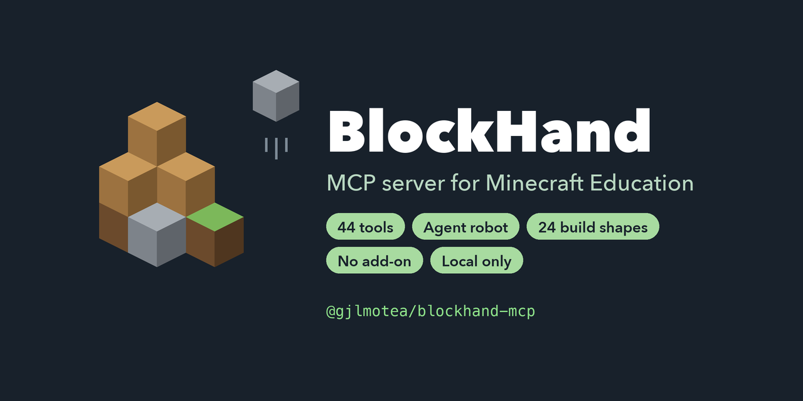

# BlockHand — MCP server for Minecraft Education

**English** | [繁體中文](README.zh-TW.md)



BlockHand gives AI agents hands and eyes inside **Minecraft Education Edition**. Claude Code, Codex, Gemini CLI, Grok or any other [Model Context Protocol](https://modelcontextprotocol.io) client can drive the Agent robot, build structures, read blocks, compare regions and react to game events.

It talks to the game only through Minecraft Education's built-in `/connect` (`/wsserver`) WebSocket command. There is **no add-on, behavior pack, mod or Script API** to install in the game, nothing is injected into the game process, and no screen reading is involved. On a school computer, the only thing to install is the AI client.

- **44 tools and 2 resources**: Agent robot control, world edits, 24 build shapes, blueprints, block reading, region comparison, symmetry checks and event subscription.
- **Fast building**: shapes are merged into the fewest possible `/fill` commands (a solid sphere of radius 8 goes from 2,000+ blocks to under 200 commands).
- **Local only**: the WebSocket listens on `127.0.0.1`, with no accounts, tokens or secrets.
- **One fixed address**: every AI session on the machine shares one background hub, so the game always connects with `/connect 127.0.0.1:19131`.
- **Installers** for Claude Code, Codex, Gemini CLI and Grok CLI when you run from source.

> The `/connect` command is an official interface. The WebSocket message protocol behind it has no published stability guarantee, so behavior should be re-checked after game updates.

## Contents

- [Quick start](#quick-start)
- [Install from source](#install-from-source)
- [Tools](#tools)
- [Connecting and staying connected](#connecting-and-staying-connected)
- [How building stays fast](#how-building-stays-fast)
- [Reading blocks](#reading-blocks)
- [Undo (off by default)](#undo-off-by-default)
- [Configuration](#configuration)
- [Safety](#safety)
- [Troubleshooting](#troubleshooting)
- [Known limitations](#known-limitations)
- [Development](#development)
- [License and trademarks](#license-and-trademarks)

## Quick start

Requirements:

- Minecraft Education Edition, in a world with **Cheats on**. The player who connects needs operator rights. Verified on 1.26.32 (Windows desktop and macOS 14+).
- Node.js 22 or newer on the machine that runs the AI client.

### 1. Register the server with your AI client

Claude Code:

```bash
claude mcp add blockhand --scope user -- npx -y @gjlmotea/blockhand-mcp
```

Codex:

```bash
codex mcp add blockhand -- npx -y @gjlmotea/blockhand-mcp
```

Any client that uses a JSON config (Claude Desktop, Gemini CLI, Cursor, VS Code and others):

```json
{
  "mcpServers": {
    "blockhand": {
      "command": "npx",
      "args": ["-y", "@gjlmotea/blockhand-mcp"]
    }
  }
}
```

Desktop apps started from Finder or the Start menu often do not see your shell's `PATH`. If the server fails to start with a vague "server not responding" error, replace `npx` with its absolute path (`which npx` on macOS, `where npx` on Windows).

Restart the AI client after registering.

### 2. Connect the game

The game connects to the server, not the other way round.

1. Open a world in Minecraft Education. The main menu is not enough.
2. Make sure Cheats are on.
3. Type in the chat:

   ```
   /connect 127.0.0.1:19131
   ```

When the connection is made, a green "✔ BlockHand connected" line appears in the chat, in the game's own language: English, Traditional Chinese or Simplified Chinese, and English for any other game language. You can also ask the AI to call `mc_status`, which returns the exact `connectCommand`.

### 3. Ask for something

> Build a hollow glass sphere with radius 6 in front of me.

> Summon the Agent, walk it five blocks forward and plant a row of wheat.

> Check whether the house at 0 64 0 to 20 80 20 is mirror-symmetric and show me which blocks break the symmetry.

## Install from source

Use this route to work on BlockHand itself, or to use the installers and the `doctor` check.

```bash
git clone https://github.com/gjlmotea/blockhand-mcp.git
cd blockhand-mcp
corepack pnpm install --frozen-lockfile
corepack pnpm run build
```

Register with one of the installers:

```bash
corepack pnpm run setup:claude    # or setup:codex / setup:gemini / setup:grok
corepack pnpm run doctor          # add --client=claude etc. to check another client
```

The installers do more than write a config entry:

- They fill in the absolute path of this machine's Node, so desktop apps that cannot read nvm, Homebrew or your shell `PATH` still start the server.
- Before changing any setting, they run a real MCP `initialize` with the exact command, arguments and environment they are about to save, and check that all 44 tools are there.
- They do nothing when the server is already registered correctly, so re-running is safe.
- When an entry with the same name exists but differs, they stop and show the difference instead of overwriting someone else's settings.
- They write only through each client's official `mcp add` / `mcp remove` command, never by editing config files directly.

Remove with `corepack pnpm run uninstall:claude` (or `uninstall:codex`, and so on). It refuses to remove entries it cannot identify as belonging to this checkout.

| Client | Writes to | Then |
|---|---|---|
| Codex | `~/.codex/config.toml` | Quit and restart; desktop app, CLI and IDE share it |
| Claude Code | `~/.claude.json` (user scope) | Restart the session |
| Gemini CLI | `~/.gemini/settings.json` (user scope) | Restart the CLI |
| Grok CLI | `~/.grok/config.toml` | Restart the CLI |

To register by hand, point the client at `<NODE> <REPO>/dist/index.js`, where `<NODE>` is the absolute path from `node -p "process.execPath"` and `<REPO>` is the absolute path of the checkout. Two client quirks: Gemini CLI takes the command and arguments as positional arguments with no `--`, and its default scope is project (use `--scope user` for global). Claude Code's default scope is local; `--scope project` writes a shareable `.mcp.json`, which is handy for a whole class.

## Tools

### Connection and fallback (6)

| Tool | Purpose |
|---|---|
| `mc_status` | Bridge state, the `/connect` command, subscribed events, command counters. Check this first when anything fails |
| `mc_await_connection` | Wait for the game to connect (up to 120 seconds per call) |
| `mc_run_command` | One raw slash command, for anything without a dedicated tool |
| `mc_run_commands` | Several raw commands in order |
| `mc_undo_control` | Inspect, clear or configure single-step undo (off by default) |
| `mc_undo` | Undo the last protected build, after checking for conflicting changes |

### Agent robot (10)

| Tool | Purpose |
|---|---|
| `mc_agent_create` | Summon the Agent |
| `mc_agent_move` | Walk N blocks in a direction |
| `mc_agent_turn` | Turn left or right by 90 degrees |
| `mc_agent_teleport` | Bring a lost Agent back to the player |
| `mc_agent_act` | Attack, destroy or till, optionally repeated |
| `mc_agent_place` | Place a block from an inventory slot |
| `mc_agent_collect` | Pick up dropped items |
| `mc_agent_inventory` | Count, free space, item detail, drop, drop all, transfer |
| `mc_agent_sense` | Inspect, inspect data, detect, detect redstone: the Agent's eyes |
| `mc_agent_program` | Send a whole sequence of actions in one call and get a result per step |

Agent directions are relative to the way the Agent is facing, not compass directions.

### World (13)

`mc_set_block`, `mc_fill`, `mc_clone`, `mc_test_block`, `mc_read_block`, `mc_verify_reading`, `mc_compare_regions`, `mc_analyze_symmetry`, `mc_query_target`, `mc_summon`, `mc_world_settings` (time, weather, game rules, difficulty), `mc_structure` (save and load structures), `mc_ticking_area`.

`mc_query_target` parses the JSON that `querytarget` returns. It is the way to find where the player or the Agent is before building.

`mc_compare_regions` compares two regions with a single `testforblocks`. Its `masked` mode ignores air in the source, which is how you check that a student's build contains everything it should, whatever else is around it.

`mc_analyze_symmetry` checks whether a region is mirror-symmetric and, when it is not, points to the cells that differ. It works by saving the region, loading a mirrored copy into a scratch area, comparing, and restoring the scratch area afterwards. The scratch area may not overlap the region being analyzed; this is checked before any command is sent. If backing up the scratch area fails, nothing is placed.

`mc_structure` saves to memory by default (gone when the game closes). Use `saveMode: "disk"` only when the user asks to keep a structure; it writes into the world folder. The game has no command that lists saved structures, so `mc_status` reports the names saved during the current session.

### Player and feedback (7)

`mc_teleport`, `mc_give`, `mc_gamemode`, `mc_effect`, `mc_player_action` (kill, clear, xp, ability), `mc_message` (say, tell, title, subtitle, action bar), `mc_feedback` (sounds and particles).

### Building (4)

| Tool | Purpose |
|---|---|
| `mc_build_preview` | Plan only: block count, bounding box, number of `/fill` batches |
| `mc_build_shape` | 24 geometric shapes; most support hollow |
| `mc_blueprint_preview` | Preview a block-by-block blueprint |
| `mc_build_blueprint` | Any shape from a list of "coordinate → block"; identical blocks are merged |

| Group | Shapes |
|---|---|
| Solids | `box`, `sphere`, `ellipsoid`, `cylinder`, `cone`, `pyramid`, `prism` |
| Lines and surfaces | `line`, `curve` (smooth curve), `disk`, `tube` (cylinder along any direction) |
| Building parts | `wedge` (single slope), `roof` (gable or hip), `arch`, `stairs`, `spiralStairs`, `polywall` (polyline wall) |
| Terrain and paths | `heightfield` (rolling ground), `ribbon` (road or bridge deck) |
| Decorative | `torus`, `helix`, `cross`, `star`, `revolution` (solid of revolution) |

With 24 shapes, the real risk is the AI picking the wrong one: a wrong pick does not fail, it builds something plausible but wrong. The tool description is therefore organized by what you want to build, with the most commonly confused pairs spelled out:

| You want | Use | Not |
|---|---|---|
| Slanted pillars, beams, pipes | `tube` | `cylinder` (axis-aligned only) |
| Walls with sharp corners | `polywall` | `curve` (rounds the corners) |
| A roof with a ridge | `roof` | `wedge` (one slope only) |
| Stairs winding up a tower | `spiralStairs` | `helix` (no treads) or `stairs` (straight) |
| Towers or chimneys that taper | `cone` / `pyramid` with `topRadius` | stacked `box`es |
| Domes, vases, cooling towers | `revolution` with a profile | a new shape per object |
| Uneven ground | `heightfield` | many `box`es |

A few parameters are easy to misread: the `radius` of `prism` and `pyramid` is the distance from the center to an edge, not to a corner; the `ridgeAxis` of `roof` is the direction the ridge runs, not the way the slopes face; `heightfield` corners are thicknesses in blocks; and `arch` draws the arch itself, with the opening (width 2 × radius − 1) in the middle.

### Events (4)

`mc_events_catalog`, `mc_events_subscribe`, `mc_events_unsubscribe`, `mc_events_poll`.

Events go into a ring buffer that you read with a cursor. `dropped > 0` means polling was too slow and some events were lost. Subscriptions are restored automatically after a reconnect. Known event names include `PlayerMessage`, `BlockPlaced`, `BlockBroken`, `ItemAcquired`, `ItemCrafted`, `MobKilled`, `PlayerTravelled`, `AgentCommand` and more (see `mc_events_catalog`). Events only fire when the thing actually happens: `BlockPlaced` is sent when a player places a block by hand, not for `/setblock` or `/fill`.

### Resources (2)

`minecraft-edu://connection` (live connection state) and `minecraft-edu://capabilities` (what the bridge can and cannot do).

## Connecting and staying connected

All AI sessions on one machine (desktop apps, CLIs, IDEs, parallel tasks) share a background **hub** that owns port 19131 and the single game connection. Each session's MCP server is a thin proxy to it. The first session that needs the hub starts it; every open session checks in once a minute, so port 19131 stays served while any session is open, and a hub that dies is restarted right away. The hub exits about 10 minutes after the last session and the game are both gone.

- Switching sessions, models or AI tools does not drop the game connection.
- `/reload all` and moving to another world do not drop it either during a normal load. At the main menu the connection stays open, but every command answers "Unknown command".
- You only need to type `/connect` again after restarting Minecraft, or after the hub side closes the connection (the chat shows "Connection closed").
- **You do not need to type `/connect` while connected.** Doing so shows nothing at all, which looks like a hang; typing and commands keep working as usual.
- `mc_run_command` can send `reload all`. For development packs, scripts and behavior pack JSON reload this way; resource packs only reload when a player types `/reload all` in the chat. Wait until the world has finished loading before sending more commands. While a load hangs, the bridge's 30-second keepalive probe keeps running, and after three unanswered probes in a row the bridge closes the connection.
- If an old BlockHand without hub support already holds 19131, new sessions fall back to standalone mode on a random port; use the address `mc_status` reports. Standalone mode never takes 19131 itself.

To reconnect quickly, press `T` in the game, press `↑` to recall the last command, then Enter.

## How building stays fast

Sending one `setblock` per block would mean tens of thousands of WebSocket round trips for a medium-sized sphere. BlockHand's pipeline is:

```
shape parameters → inside() test over the bounding box → set of block coordinates
  → merge runs along X → merge rectangles along Z → merge boxes along Y (3-stage greedy)
  → split by the 32,768-block /fill limit
  → send
```

The merge is deterministic, and tests pin that the merged batches cover exactly the original set of blocks, no more and no less. Hollow shapes all come from the same "inside test plus shell-neighbor test", so a new shape only needs an `inside()` function. `tests/domain/fill-efficiency.test.ts` sets an upper bound on fill commands per block for every shape.

For very large terrain work, compute the coordinates yourself and send many `/fill` commands with `mc_run_commands` (200 per call), or write a `.mcfunction` file and run it with `/function`. See [agents/docs/large-builds.md](agents/docs/large-builds.md) for the limits involved.

## Reading blocks

Minecraft Education has no command that simply returns the block at a position, so reading has built-in limits:

- `mc_test_block` is a yes/no question: you have to guess a block ID.
- `mc_read_block` does not need a guess. It asks whether the block is air, and when the answer is no, the game's error message names the actual block. The result is the localized display name ("Dirt"), not the block ID (`dirt`).
- When the message cannot be parsed, `mc_read_block` returns an error, never a successful response with `block: null`. The consumer is an AI, and an AI that sees a successful `null` will confidently treat the spot as empty and may build over a student's work.
- `mc_verify_reading` checks that the parsing still works, with at most two read-only commands. Run it after a game update, after changing the game language (supported: Traditional Chinese, Simplified Chinese, English), or whenever `mc_read_block` starts failing on blocks you can see. Mutation tests make sure the probe and the parser turn red when the parsing rules are broken.

Reading a whole region block by block would need a behavior pack and the Script API, which BlockHand deliberately avoids so that school computers need no extra installs.

## Undo (off by default)

> Automatic undo is **off by default**. On Minecraft Education 1.26.32 (macOS), the native region check that undo sends before the first small build (`body.version=25`) never got a reply; after that, every command on the connection timed out, including what the player typed in chat, and only restarting Minecraft recovered. This was reproduced three times. Turn it on with `MINECRAFT_EDU_UNDO_ENABLED=1` or `mc_undo_control` with `configure enabled=true` only if you accept that risk. Design notes: [agents/docs/undo/region-undo.md](agents/docs/undo/region-undo.md).

When enabled, undo keeps one operation of up to 4,096 blocks, snapshotted in game memory with `structure save ... memory` (nothing is written to disk). There is no redo. It covers the overworld, absolute integer coordinates and basic static building blocks; unsupported builds are rejected before anything is changed.

## Configuration

Everything has a default; no `.env` file is needed.

| Variable | Default | Meaning |
|---|---|---|
| `MINECRAFT_EDU_WS_HOST` | `127.0.0.1` | Listen address; loopback only by default |
| `MINECRAFT_EDU_WS_PORT` | `19131` | Port the game connects to. The default uses the shared hub; any other value (such as `0`) runs an isolated standalone bridge |
| `MINECRAFT_EDU_HUB` | auto | `0` disables the hub (one bridge per session); `1` forces the hub on a custom port |
| `MINECRAFT_EDU_HUB_PORT` | `19132` | Local control port the sessions use to reach the hub; also the lock that decides which process is the hub |
| `MINECRAFT_EDU_HUB_DIR` | `~/.blockhand` | Hub state file `hub.json` (with an access key readable only by the local user) and the log `hub.log` |
| `MINECRAFT_EDU_HUB_IDLE_MS` | `600000` | The hub exits after this long with no session check-ins and no game connection |
| `MINECRAFT_EDU_CONNECT_NOTICE` | on | Show the green "✔ BlockHand connected" line in chat, in the game language (detected with one read-only `time query daytime` first); `0` turns it off |
| `MINECRAFT_EDU_WS_PORT_FALLBACK` | `1` | Pick a free port when the preferred one is taken; `0` fails instead |
| `MINECRAFT_EDU_COMMAND_TIMEOUT_MS` | `10000` | How long to wait for the game to answer one command |
| `MINECRAFT_EDU_KEEPALIVE_INTERVAL_MS` | `30000` | Interval of the idle keepalive probe (`time query daytime`); three unanswered probes in a row close the connection |
| `MINECRAFT_EDU_EVENT_BUFFER` | `500` | Event ring buffer size |
| `MINECRAFT_EDU_MAX_BUILD_BLOCKS` | `40000000` | Maximum blocks per build; non-solid shapes are also capped at an 8,000,000-block scan volume |
| `MINECRAFT_EDU_UNDO_ENABLED` | `0` | `1` turns on automatic single-step undo (see the warning above) |
| `MINECRAFT_EDU_UNDO_MAX_BLOCKS` | `4096` | Undo budget, 1–32,768 blocks, in at most 64 regions |
| `MINECRAFT_EDU_STEP_DELAY_MS` | `100` | Default delay between Agent program steps |
| `MINECRAFT_EDU_DEBUG_FRAMES` | unset | `1` prints every raw frame from the game to stderr |

## Safety

- The WebSocket listens on `127.0.0.1` only. Nothing connects to the internet.
- The MCP runtime does not write files on the host. The one exception is `mc_structure` with `saveMode: "disk"`, which makes the game write a structure into its world folder; the tool reply says where.
- No secrets, tokens or accounts are involved.
- `mc_run_command` accepts slash commands, which only act inside the local game world. Its gate is structural rather than a keyword blocklist:
  1. One line only. Newlines and NUL are rejected, so one request cannot become two commands.
  2. Commands that would cut or redirect the bridge are refused: `wsserver`, `connect` and `closewebsocket`, including when wrapped in `execute`.
  3. Everything else is tagged `read-only`, `world-write` or `wide-effect`, so the MCP host can ask for confirmation based on the tool annotations.
- Block IDs, selectors and state strings that go into a command line are checked against allow-list patterns first, so spaces cannot smuggle in extra arguments.
- On a shared hub, only one AI session can change the world at a time. A second session's write tool is refused immediately with a clear message; read-only tools are not affected.

## Troubleshooting

**The player says chat stopped responding.** Do not restart the game first. Check, in order:

1. What the game screen shows (in a world, main menu, or a loading screen).
2. `mc_status`: `commandState: "timed-out"` means the bridge's own commands are not being answered either.
3. Subscribe to `PlayerMessage` and ask the player to type a line. Player chat produces a `type: "chat"` event. Not receiving one is not proof by itself, because a subscription is not confirmed by the game; compare with the screen.
4. The last lines of `~/.blockhand/hub.log` (every line is timestamped, rejected handshakes are logged too).

When a built-in command such as `time` answers "Unknown command", the tools add a hint: the game is most likely not in a world.

**`mc_status` shows a port other than 19131.** Another process holds 19131. Find it with `lsof -nP -iTCP:19131 -sTCP:LISTEN` (macOS) and check whether the hub is running with `ls ~/.blockhand`.

**Windows, Microsoft Store (UWP) version.** Windows app isolation blocks loopback connections. Grant an exemption with `CheckNetIsolation LoopbackExempt`.

**A large build gets cut off.** MCP clients usually time out requests after about 60 seconds, while the tool keeps sending fills. Check `fillBatches` with `mc_build_preview` first and split large builds.

## Known limitations

- **Text from the game stays in the game's language.** Tool descriptions, server instructions and error messages are in English, but what the game itself returns (`statusMessage`, and the block names from `mc_read_block`) comes back in the game language.
- The world must have Cheats on; otherwise the game rejects every command.
- The Agent exists only in Education Edition.
- Event names and the `agent` subcommands are not formally documented by Mojang; they come from public observation and may change with game updates. `mc_events_subscribe` accepts names outside the known list but marks them unverified.
- `@s` does not always resolve for commands sent over WebSocket, so `mc_query_target` defaults to `@p`.
- Some responses arrive with a request ID that matches no request. When exactly one request is pending and no timeout has happened on the connection, the bridge may attribute the response by inference and logs it; after any timeout it only accepts exact matches. Modifying commands are never resent automatically.
- Commands are sent one at a time with a queue of at most 64; anything beyond that is refused with `command-queue-full`, and queued commands that outlive their own timeout are dropped and reported as not sent.
- After rebuilding, the running hub keeps the old version until it restarts; a hub restart drops the game connection.

## Development

```bash
corepack pnpm run verify   # typecheck, tests, build, stdio smoke, shared-hub smoke
corepack pnpm run live     # end-to-end check against a running game (prints the /connect to type)
```

`live` walks through connect, read player position, chat, set time, summon the Agent, sense, walk an L-shaped path, preview and build a hollow glass sphere, verify the blocks, merge a blueprint, receive events, test the command gate and clean up. Add `--keep` to `node scripts/live-check.mjs` to keep the demo build.

```
src/
  domain/          pure logic, no MCP, ws or Node dependencies
    commands.ts            slash command builders and injection allow-lists
    command-policy.ts      structural gate for raw commands
    build/shapes.ts        the 24 shapes: inside() plus shell-neighbor test
    build/fill-planner.ts  3-stage greedy merge and batch splitting
    build/undo-plan.ts     undo regions, budgets and native region checks
  adapters/ws-minecraft-connection.ts   WebSocket server, request matching, events, reconnects
  application/     services: Agent programs, querytarget parsing, building, undo
  hub/             shared hub, session proxy, cross-session write lock
  server/          MCP server, schemas and the tools
  composition.ts   wiring; accepts a fake connection for tests
  index.ts         stdio entry point
```

The domain layer knows nothing about WebSockets, so the whole MCP tool pipeline is tested with in-memory fakes, without a running game.

## License and trademarks

[MIT](LICENSE).

NOT AN OFFICIAL MINECRAFT PRODUCT. NOT APPROVED BY OR ASSOCIATED WITH MOJANG OR MICROSOFT. Minecraft and Minecraft Education are trademarks of Mojang Studios and Microsoft. BlockHand is an independent open-source project.
